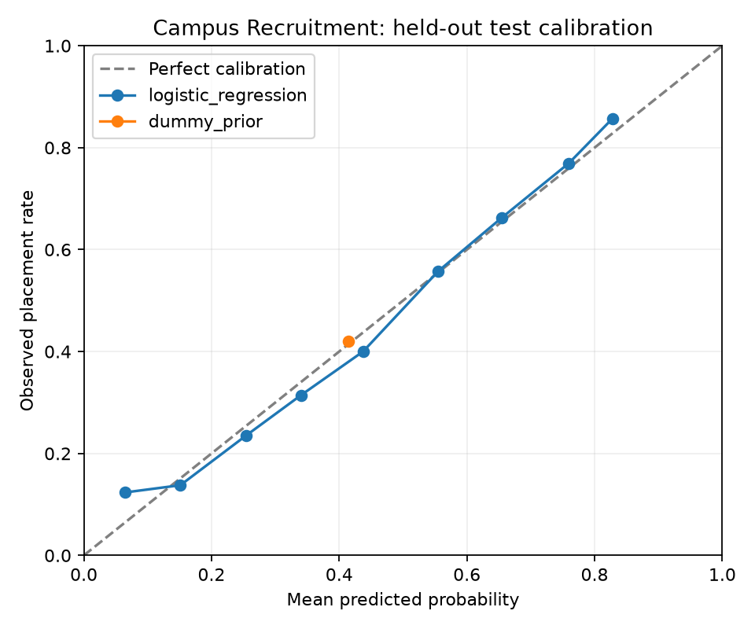

# Đánh giá mô hình placement với hai đầu vào

Mô hình Campus Recruitment xuất JSON cho frontend; xem kiểm tra đối chiếu Python/TypeScript trong npm test. Nguồn thu thập của dataset còn hạn chế; chưa xác nhận thật/giả lập và chưa kiểm định trên UIT hoặc doanh nghiệp Việt Nam.

## Dữ liệu và chống trùng

Keep source splits; protect test > validation > train using all original predictor columns. Deduplicate identical predictor+label rows within each retained split. Keep differing labels within the winning source split.

Giữ nguyên tất cả CSV nguồn. Không coi việc trùng hai đầu vào của model là cùng một người. Không có ID để xác minh danh tính hồ sơ.

| Tập | Gốc | Sau lọc |
|---|---:|---:|
| train | 7225 | 7150 |
| validation | 1275 | 1273 |
| test | 1500 | 1500 |

Có 72 dòng dư trùng toàn bộ predictor và nhãn, 33 nhóm predictor giao nhau giữa các tập và 8 nhóm predictor có nhãn khác nhau trước lọc. Nhãn khác nhau ở hồ sơ giống nhau không tự động là lỗi; giữ các nhãn khác nhau trong tập ưu tiên được giữ.

## Phương pháp

X chỉ gồm CGPA và Projects theo đúng thứ tự. Không dùng số lần hoặc số tháng thực tập. Nhãn Placed = 1, NotPlaced = 0. Không dùng điểm vòng 2 hoặc kết quả HR.

Median imputer và StandardScaler chỉ fit trên train. So sánh Logistic Regression với DummyClassifier dự đoán tỷ lệ Placed của train. Không dùng trọng số cân bằng lớp hoặc hiệu chỉnh xác suất sau train.

Thử C = [0.01, 0.1, 1.0, 10.0, 100.0], chọn C = 0.1 theo Brier score trên validation (thấp hơn tốt hơn). Giữ model đã fit trên train, không fit lại train + validation. Test chỉ dùng báo cáo cuối sau khi chọn C.

## Kết quả test

| Model | ROC AUC ↑ | Average Precision ↑ | Brier ↓ | Log loss ↓ |
|---|---:|---:|---:|---:|
| logistic_regression | 0.807033 | 0.726796 | 0.173342 | 0.527059 |
| dummy_prior | 0.500000 | 0.420000 | 0.243635 | 0.680363 |

Biểu đồ gom xác suất thành 10 khoảng cố định; JSON lưu số mẫu và tỷ lệ quan sát ở từng khoảng. Biểu đồ là kiểm tra độ khớp, không phải bước hiệu chỉnh model. Không chọn lại cấu hình sau khi xem test.

Export JSON đã đối chiếu với sklearn trên 15 đầu vào lấy từ train hoặc mẫu thiếu đầu vào; sai số lớn nhất 5.55e-17. Các mẫu này được dùng để đối chiếu TypeScript qua npm test sau khi export.

## So sánh với bản ba đầu vào

Tham chiếu trước đây dùng CGPA, Projects, Internships trên cùng tập test (ROC AUC 0.807996; Brier 0.173321). Bản hai đầu vào được chốt theo yêu cầu đơn giản hóa form, không chọn theo điểm test. Đây là so sánh mô tả trên test đã xem, không phải đánh giá độc lập mới.

## Giới hạn

Chỉ số phản ánh tập đã lọc trùng của nguồn này, không chứng minh xác suất tuyển dụng thật tại UIT. Việc lọc theo hồ sơ giống nhau làm thay đổi quần thể đánh giá. Thiếu ID nên chưa chứng minh tính độc lập theo người hoặc theo thời gian.

GPA ngoài phạm vi học cần cảnh báo, không ép về biên. Thiếu đầu vào dùng median train theo model; giá trị 0 vẫn là 0. Quy đổi GPA thang 4 sang 10 cần quy tắc demo rõ ràng, không gọi là chuẩn UIT.

Model chỉ hỗ trợ tham khảo; không thay rubric, ngưỡng top 10, quyết định HR hoặc giả định offer 75%.
